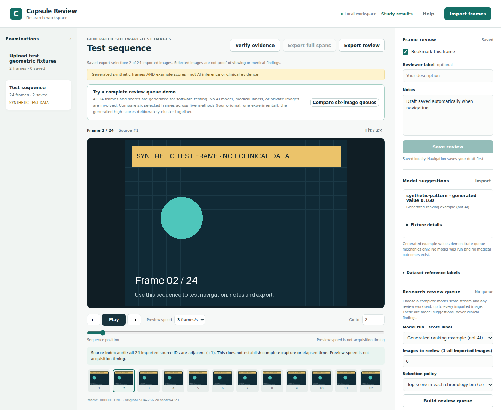
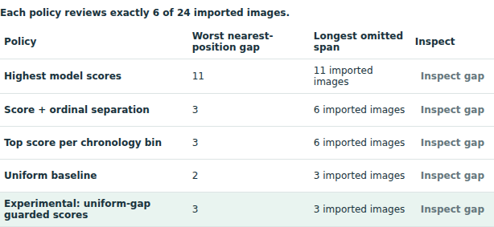

# Capsule Review

A local research viewer for images recorded by a swallowed camera, with experiments on which images to select when only a fixed number can be reviewed.



*The working local viewer with synthetic demonstration images. Generated scores are software examples, not predictions from the evaluated blood CNN.*

An **annotation run** is a sequence of consecutive blood-positive labels at the dataset’s sampled image intervals. Run recall measures the fraction of those sequences reached by at least one selected image. At the same number of images reviewed, can model-guided selection reach more runs than evenly spaced (uniform) sampling? A model that retrieves many images from one long positive region may still miss several short events. Whether these runs represent clinically distinct findings requires expert review.

## Results

Score-per-bin selection chooses the highest-scoring image in each chronological segment. Uniform selection chooses evenly spaced images; both use the same image count.

A locked retrospective study used **163,161 source-verified Galar images from ten examinations**. At a prespecified **10% image-review budget**, the score-per-chronological-bin policy reached **49.35%** of blood-positive annotation runs on average across the six positive-run examinations, versus **50.62%** for uniform selection (**−1.27 percentage points**). Uniform performed better at the primary budget. At the secondary 25% budget, score-per-bin was 9.51 percentage points higher, with results varying by examination.

At 10%, unrestricted highest-score ranking retrieved **305 blood-positive images but only 28 of 154 distinct positive annotation runs**; uniform sampling retrieved **170 positive images across 63 runs**. More positive *frames* did not mean more distinct positive *runs*. These runs are dataset annotations, **not independently adjudicated lesions**.

Read the [short scientific synthesis](docs/RESEARCH_COLLABORATION_BRIEF.md), [locked evaluation report](docs/GALAR_UNSEEN_11_20_RESULTS.md), and [current research status](docs/PROJECT_STATUS.md). The [research plan](docs/ROADMAP.md) distinguishes active work from historical experiments.

## The software

Capsule Review is a **localhost-only FastAPI/JavaScript viewer** for image-sequence navigation, human notes/bookmarks/intervals, imported model-score inspection, deterministic exact-*K* review queues, omission inspection, and verifiable evidence exports. Scores never automatically become human findings. The viewer retains access to images not selected by a queue.

The public demonstration uses **24 synthetic images and generated scores**, not predictions from the privately evaluated blood CNN. No medical images or trained pathology weights are distributed.



*Frame-selection comparison using deterministic generated scores on the synthetic sequence. These queue examples are separate from the Galar research results above. Open either screenshot at full size to inspect the controls.*

```bash
python3 -m venv .venv
. .venv/bin/activate
python -m pip install -e .
capsule-review serve
```

Open `http://127.0.0.1:8765` and choose **Open test sequence**. Windows instructions and a five-minute walkthrough are in the [demo guide](docs/SUPERVISOR_DEMO.md). For source-only test verification, run `python -m pip install -e '.[dev]'` and `python -m pytest -q`.

## Research boundaries

- **No clinical model was promoted.** This is **not a clinical decision-support device**; medical efficacy, patient-independent generalization, and clinician reading-time savings are unproven.
- Galar examination IDs have not been authenticated as unique patient IDs. The ten-examination 11–20 evaluation is already inspected, and the original dataset authors' **61–80** holdout remains unopened.
- Later examination-held-out short-event experiments did not establish reliable cross-examination improvement. A 137-image blinded expert-interpretation pilot is *prepared, not clinically reviewed*. No research collaborator has been sent the images.
- Private research inputs, original medical images, labels, scores, and weights are excluded from this public repository. The source is publicly visible but **has no software licence**; do not assume permission to redistribute it.

## Where to look

| Purpose | Location |
| --- | --- |
| Core viewer and selectors | `src/capsule_review/` |
| Minimal demonstration | [Five-minute walkthrough](docs/SUPERVISOR_DEMO.md) |
| Scientific question, methods and main findings | [Research synthesis](docs/RESEARCH_COLLABORATION_BRIEF.md) |
| Primary outcome and frozen commitments | [Locked 11–20 report](docs/GALAR_UNSEEN_11_20_RESULTS.md) |
| Active scientific decision and next evidence gate | [Status](docs/PROJECT_STATUS.md) · [Plan](docs/ROADMAP.md) |
| Dated reproducibility material | `docs/` · `experiments/` · `scripts/` |
| Synthetic and application tests | `tests/` |

Historical protocols, failed experiments and aggregate results are retained for auditability. They should not be mistaken for active model recommendations.
